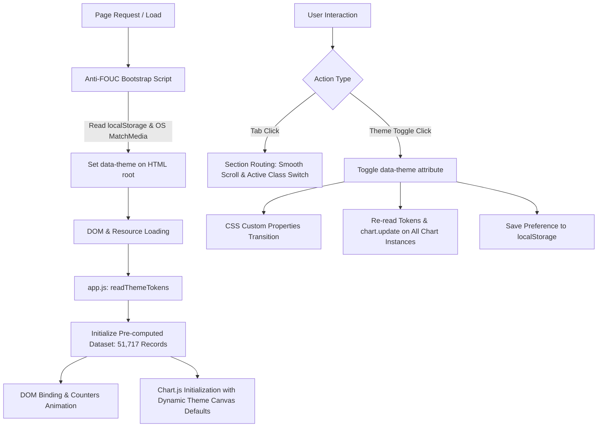

# 🍽️ Zomato Bangalore Restaurant Analytics Dashboard

> An editorial, artisanal data visualization dashboard exploring **51,717 restaurants** across Bangalore, India. Crafted with a humanized design aesthetic, organic color palettes, dynamic light/dark theming, and responsive analytics.

---

## 📖 1. Project Overview & Story

Bangalore (Bengaluru), widely celebrated as the Silicon Valley of India, is equally renowned as the nation's culinary crucible. From legacy filter-coffee Darshinis and bustling South Indian tiffin rooms to high-energy microbreweries and avant-garde dining destinations, the city's food culture reflects its diverse, cosmopolitan populace.

Behind this culinary tapestry lies a massive, intricate food economy. This project takes the **Zomato Bangalore Restaurants Dataset (51,717 records)** and transforms raw transactional data into an **editorial, human-centered analytics dashboard**. 

Rather than presenting cold, clinical SaaS dashboards with neon charts and sterile metrics, this project was conceived as a **digital culinary journal**—combining print editorial typography, warm tactile tones, and reactive data visualizations to answer fundamental questions:
- *Where is the epicenter of Bangalore's food scene?* (BTM Layout dominates with 5,124 eateries).
- *Is Bangalore dining actually affordable?* (Over 46% of eateries serve two people for under ₹400).
- *How dominant is digital food delivery?* (58.9% of restaurants support online delivery).
- *What do Bangaloreans love to eat?* (North Indian, Chinese, and South Indian form over 65% of all cuisine listings).

---

## ✨ 2. Key Features & Highlights

### 📑 Multi-Tab Editorial Sections
1. **Overview Dashboard**: High-level KPI metric cards with live counter animations, aggregate listing types (Delivery, Dine-out, Cafes, Pubs), and dual reservation/online delivery donuts.
2. **Ratings Breakdown**: Granular star distributions across 41,665 rated restaurants, service format breakdown, and tiered quality segments (from *Top Tier Excellence* to *Needs Improvement*).
3. **Cuisine Explorer**: Deep dive into Bangalore's top 20 cuisines, service format distribution pie charts, and interactive sizing bubbles weighted by citywide popularity.
4. **Location Intelligence**: Geographic ranking across 93 neighbourhoods, an interactive top-location leaderboard, and an intensity-mapped density heatmap.
5. **Cost & Affordability**: Meal-for-two price distribution (₹40 to ₹6,000), spend benchmarks by restaurant category (from sweet shops to fine dining), and value metrics.
6. **Data-Driven Insights & Reference**: Curated storytelling cards highlighting city trends paired with a complete metrics reference table.

### 🎨 Handcrafted, Humanized Design Philosophy
- **Tactile Color Theory**: Completely avoids harsh pure blacks (`#000000`) and pure whites (`#FFFFFF`). Light mode uses warm linen (`#F7F4EF`) and cream cardstock (`#FBF9F5`) with terracotta (`#C4593D`), sage green (`#6B8C6E`), and warm ochre (`#C4883A`).
- **Dark Mode (Espresso & Copper)**: A soothing, low-contrast dark mode featuring rich espresso tones (`#181615`), warm parchment typography (`#EBE5DC`), and ambient copper highlights that feel like reading under a library desk lamp.
- **Seamless Live Theme Sync**: Zero-reload theme toggle with anti-FOUC (Flash of Unstyled Content) prevention, automatic `prefers-color-scheme` detection, `localStorage` persistence, and instant Chart.js canvas restyling.
- **Editorial Typography**: Pairing serif elegance (**Lora**) for headings and numbers with humanist geometric sans (**DM Sans** / **Inter**) for UI elements.
- **Subtle Physical Textures**: Organic border radii, warm amber drop shadows, and microscopic paper grain overlays that simulate physical print media.

---

## 🛠️ 3. Tech Stack

- **Markup**: `HTML5` (Semantic layout, accessible ARIA roles, inline SVG iconography).
- **Styling**: `CSS3` (Custom Properties / CSS Variables, Modern CSS Grid, Flexbox, glassmorphic headers, tactile shadows, fluid responsive typography).
- **Interactivity & Logic**: Vanilla `JavaScript (ES6+)` (DOM routing, theme state engine, requestAnimationFrame easing counters, theme event broadcasting).
- **Data Visualization**: `Chart.js v4.4.0` (Bar charts, Doughnuts, Horizontal rankings, scriptable background color evaluators).
- **Typography**: Google Fonts (`Lora` Serif & `DM Sans` / `Outfit` Sans-Serif).

---

## 📊 4. Dataset Information

The dashboard visualizes the comprehensive **Zomato Bangalore Restaurants** dataset:
- **Total Records**: `51,717` restaurant entries.
- **Rated Records**: `41,665` active ratings (Citywide mean: `3.7 / 5.0`).
- **Neighbourhoods Covered**: `93` distinct Bangalore localities (BTM Layout, HSR, Koramangala 1st–7th Blocks, Indiranagar, Whitefield, Jayanagar, etc.).
- **Price Range**: Minimum `₹40` to Maximum `₹6,000` for two diners (Citywide median: `₹555`).
- **Digital Adoption**: `30,444` restaurants (58.9%) support online ordering; `6,449` (12.5%) support table reservations.
- **Cuisine Taxonomy**: 70+ unique culinary styles aggregated into top 20 distinct categories.

---

## 🏗️ 5. Architecture & Workflow

The application operates as a high-performance, dependency-free Single Page Application (SPA). All metrics are pre-aggregated for instantaneous load times and zero network latency.

### Mermaid Workflow Diagram



### Text Flow Architecture
```text
[Dataset: 51,717 Rows]
       │
       ▼
[Pre-computed Analytics Model] ───► [app.js State Engine]
                                           │
         ┌─────────────────────────────────┼───────────────────────────────┐
         ▼                                 ▼                               ▼
[Tab Routing & Sections]         [Chart.js Visualizations]       [Live Easing Counters]
  • Overview                       • Listing Type Bar              • Total Count (51.7k)
  • Ratings                        • Online / Booking Donuts       • Average Rating (3.7)
  • Cuisine                        • Rating Distribution Bar       • Unique Locations (93)
  • Location                       • Top Cuisines & Formats        • Average Votes (284)
  • Cost                           • Location Leaderboard
  • Insights                       • Price Segment Breakdown
                                           │
                                           ▼
                            [Dynamic Theme Synchronization]
                              • Light Mode: Warm Linen
                              • Dark Mode: Espresso & Copper
                              • In-place Canvas Restyling
```

---

## 📁 6. Project Structure

```text
zomato-bangalore-analytics/
├── index.html        # Semantic HTML5 markup, SVG sprites, anti-FOUC theme loader
├── style.css         # Complete editorial design system, dark/light theme tokens, grid layouts
├── app.js            # Pre-computed dataset (51,717 records), Chart.js configs, SPA navigation
├── .gitignore        # Ignores large raw CSV files, temporary files, and OS artifacts
└── README.md         # Professional documentation & developer guide
```

---

## 🚀 7. Setup & Installation Guide

Because this application relies exclusively on standard web technologies, there are **no build steps, bundlers, or package installations** required.

### Option A: Direct Browser Launch
1. Clone or download the repository to your local system.
2. Locate `index.html` in your file explorer.
3. Double-click `index.html` or drag it into any modern web browser (Google Chrome, Mozilla Firefox, Microsoft Edge, Safari).

### Option B: Local Development Server (Recommended)
Running through a local web server ensures seamless loading of CDN libraries and storage APIs:

#### Using VS Code Live Server:
1. Open the project folder in **Visual Studio Code**.
2. Install the **Live Server** extension (by Ritwick Dey).
3. Right-click `index.html` and click **"Open with Live Server"**.

#### Using Python:
```bash
# Python 3.x
python -m http.server 8000
```
Then visit `http://localhost:8000` in your browser.

#### Using Node.js (`npx`):
```bash
npx serve .
```

---

## 📤 8. Git Push Instructions

Follow these step-by-step commands in your terminal (PowerShell, Command Prompt, or Git Bash) to publish this repository to GitHub.

> ⚠️ **Important Note Regarding Raw Data Files**:
> The raw `zomato.csv` dataset is ~574 MB. GitHub rejects files larger than 100 MB. Ensure `.gitignore` is in place before committing.

### Step 1: Open Terminal in Project Directory
```bash
cd "path/to/your/project"
```

### Step 2: Initialize Git & Verify Ignore Rules
```bash
# Initialize a new Git repository (if not already done)
git init

# Verify that large CSV files are ignored
git status
```

### Step 3: Stage All Project Files
```bash
# Stage the web application files
git add index.html style.css app.js README.md .gitignore
```

### Step 4: Commit with a Clean Conventional Commit Message
```bash
git commit -m "feat: complete editorial Zomato Bangalore analytics dashboard with dynamic dark mode"
```

### Step 5: Link Remote GitHub Repository
1. Go to [GitHub](https://github.com/new) and create a new repository (e.g., `zomato-bangalore-analytics`).
2. Do **not** initialize with a README, .gitignore, or license (we already created them).
3. Link your local repo to GitHub:

```bash
# Rename current branch to main
git branch -M main

# Add your GitHub repository as remote origin (replace with your URL)
git remote add origin https://github.com/<your-username>/zomato-bangalore-analytics.git
```

### Step 6: Push to GitHub
```bash
# Push and set upstream tracking
git push -u origin main
```

---

## 📄 License & Attribution
- **Dataset**: Sourced from the Zomato Bangalore Restaurants dataset on Kaggle.
- **Design & Code**: Crafted with pride as an open-source analytics & data design demonstration.
- **License**: MIT License. Feel free to fork, customize, and build upon this project.
